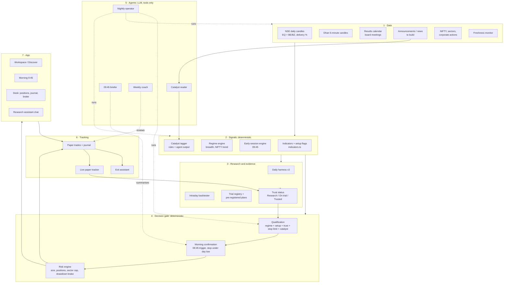

# SwingDesk trading desk: architecture

Status: proposed 2026-11-20. Purpose: a personal NSE swing-trading desk that only suggests trades in good conditions, keeps every loss small and known in advance, and measures whether it works. Orders are placed by hand; nothing here sends broker orders.

## Principles

1. **Rules decide, AI assists.** Every buy, skip, size and exit decision comes from versioned, testable rules. LLM agents read, summarise, orchestrate and coach. They never decide a trade or change a rule.
2. **Capital first.** Regime gate, stop limit, position cap and drawdown brake sit in front of every suggestion.
3. **One definition of a trade.** The scanner, the backtests, the paper tracker and the journal share the same entry, stop, target and exit rules.
4. **Evidence before money.** Every rule set moves Research only → On trial → Trusted, through pre-registered tests and a live paper record.
5. **"No trade today" is a valid output.**

## Layers

## Components

| Layer | Component | Responsibility | Status |
|---|---|---|---|
| Data | NSE daily candles (`DailyCandle`) | EOD OHLCV, delivery %, EQ/BE/BZ series | Built; BE/BZ fixed 2026-11-20 |
| Data | Dhan 5-minute (`IntradayCandle`) | Intraday history and today's bars | Built; 3-year backfill running |
| Data | Results calendar (`ResultsEvent`) | Board-meeting dates | Built (dates only) |
| Data | Announcements / news | Order wins, results numbers, approvals | **To build** (catalyst reader) |
| Data | Freshness monitor | Flags stale feeds, expiring Dhan token | Partly built |
| Signals | Indicators and setup flags | VCP, squeeze, EP, trend, relative strength… | Built; first-match classifier to become independent flags |
| Signals | Regime engine | % of top 500 above their 50-day average, NIFTY vs 50/200-day averages → GREEN / AMBER / RED | **Building now** |
| Signals | Early-session engine (`src/earlySession.ts`) | 09:45 volume + sector + breakout | Built (research only) |
| Signals | Catalyst tagger | Results within 5 sessions, sector strength, agent tags | **Building now** (results + sector); agent tags later |
| Research | Daily harness v3, intraday backtester, trial registry | Pre-registered tests with controls | Built |
| Decision | Qualification gate | Show a setup only if regime allows, stop ≤ limit, trust status known | Partly built (stop limit) |
| Decision | Morning confirmation | Evening watchlist → buy only if 09:45 price is above yesterday's high, stop under the day's low ≤ 2.5% | **Building now** |
| Decision | Risk engine | 0.5–2% risk a trade, ≤ 20% a position, max positions, sector cap, −5% drawdown brake | Sizing built; **brake building now** |
| Agents | Nightly operator | Run data load → regime → scan → catalysts → watchlist, report failures | Later |
| Agents | Catalyst reader | Read announcements for watchlist stocks, tag positive / negative / neutral with source | Later (next big piece) |
| Agents | 09:45 briefer | "Market GREEN, 2 confirmed, plans attached" | Later |
| Agents | Weekly coach | Review journal: where losses come from, rule breaks | Later |
| Tracking | Paper trades, journal stats, exit assistant | R-based plans, trailing stop, time stop, stats per setup and regime | **Building now** |
| App | Workspace, Morning, Desk, Assistant | One place to see, plan and review | Workspace and Morning built; **Desk building now** |

## A trading day

| Time (IST) | Step | Output |
|---|---|---|
| After 16:30 | Load NSE data, check freshness, compute regime | GREEN / AMBER / RED for tomorrow |
| Evening | Scan → qualification gate (regime, stop limit, trust) → catalysts | Watchlist with plans, or "No qualified trade today" |
| 09:45 | Morning confirmation for the watchlist; early-session scan | Confirmed trades: buy-up-to price, stop, +5% target, shares |
| During the day | You place orders manually; record the paper or real trade | Journal entry with setup and regime |
| Each evening | Exit assistant | Hold / take half at +5% and move stop to entry / trail / time stop after 7 sessions |
| Weekly | Journal stats; coach review later | Win rate, average win and loss, R per setup and regime |

## Default trading rules (v1, untested until backtested)

| Rule | Value |
|---|---|
| Regime | GREEN: NIFTY above its 50-day average **and** at least 50% of the top 500 above their 50-day averages. RED: NIFTY below its 200-day average **or** under 35% above. Otherwise AMBER. New setups only in GREEN; AMBER shows them with a warning; RED shows none. |
| Entry | Evening watchlist; buy only after 09:45 confirmation, no more than 0.3% above the 09:45 price |
| Stop | Under the day's low at 09:45; skip if more than 2.5% away |
| Target | Sell half at +5%, move the stop to entry, trail the rest under the previous session's low |
| Time stop | Exit after 7 sessions if neither stop nor target was hit |
| Risk | Your saved risk % per trade, ≤ 20% of capital a position, your max positions and sector cap |
| Drawdown brake | If equity falls 5% below its peak, no new trades for 7 days |

These values are set before any test. The regime rule will be backtested on V3, V4 and the 20 setup types, with and without the gate, before it's treated as an edge.

## Build order

1. Regime engine and gate → Workspace banner and Discover gating.
2. Morning confirmation of the evening watchlist (Morning tab).
3. R-based plan on every card (entry, stop, +5%, trail, time stop).
4. Catalyst column: results within 5 sessions, sector 5-day strength rank.
5. Desk tab: open positions with exit advice, drawdown brake, journal statistics per setup and regime. Recording a trade saves its setup type and regime.
6. Backtest: V3, V4 and the 20 setups with and without the regime gate.
7. Later: catalyst-reader agent, nightly operator, 09:45 briefer, weekly coach.
